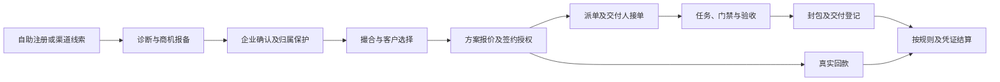

# M0 现行业务流程

收割来源为[接单到交付贯通验收报告](../audit/贯通验收报告-接单到交付-2026-11-17.md)、[贯通脚本](../../scripts/verify/verify_order_to_delivery_e2e.py)、[商业阶段状态](../commercialization/phase-status.md)与 ADR-011。本轮查阅历史验收和脚本，未执行包含写入的贯通脚本。

图中分支表示回款和验收共同进入结算审核，具体付款节点由签约文件确定。

| 环节 | 可引用的证据 | M1 待验证 |
|---|---|---|
| 注册、渠道与诊断 | `test_registration_surface.py`、`test_diagnostics_lead_claims.py`，历史公网诊断冒烟脚本 `scripts/verify/verify_diag_public_live.py` | 在选定环境核对手机可达、注册审核、免费额度与渠道归因。真实发信按授权执行，并核验退订是否生效 |
| 归属、保护期与撮合 | 贯通报告 §7-C 席位激活后补验至撮合，商业化阶段状态 G4 | 自注册撞企业既有报备、跨区域授权、客户选择与申诉留痕 |
| 方案、报价、成交与派单 | 11-17 贯通验收使用合成代号走通方案、报价、成交、指派及本人接单 | 对实际首单记录标准报价的适用性、签约权限、计提基数、实际档位和回款凭证 |
| 任务、门禁、封包及登记 | 11-17 贯通报告与 §7 补验覆盖项目到 `delivered`；11-20 历史回执登记 27 PASS / 2 SKIP / 0 FAIL，按非首单路径运行 | 企业实际验收、手机端操作及换人执行回执 |
| 真收款、计提、税票与应付款 | F 线 T0–T8 阶段状态、ADR-011、`test_f_line_t6_tax_invoice_reconciliation.py`。贯通报告 §7-C 仅通过结算负例，将真实结算留给 F 线 | 样单贯穿合同、实收、科目、五席位明细、税票及应付款。首签前关闭 DIFF-09 |

`project_share` 科目行引用既有交付结算，五席位明细按收款主体归集。商机结算登记校验科目行与撮合包一致，并拒绝复用已用于其他商机的科目行。仓内批 D 正例使用合成夹具，证明登记约束；实际收款、应付款、打款与入账仍需同一笔样单的凭证。[科目层](../../server/src/fde_api/commercial/ledger_service.py#L630) · [专项回归](../../server/tests/test_crv_batch_d.py#L200)

历史 somwyn 结项记录显示 C 款 ¥3,300 里程碑触发，采用记账模式。本轮经营验收仍缺实际到账凭证的授权核对及异人复跑证据。证据原件由本地真相层管理。11-20 复跑数字引自当日历史回执登记，仓内 11-17 报告及验证脚本各自保留独立证据范围。

## 薄切片验收

每片一个创业者、一个企业、一个交付者。招募观察仅登记授权范围内的人选和手机网页可达性。签约、收费分别依决策登记。每片记录实际到账、逐单成本、创始人工时和 time-to-first-yuan。成功片附闭环证据，失败片记录阻塞点、归因及下一片修正。另一组人使用相同材料完成第二次闭环后才有初步复制证据。扩片同时走招商策划 §八、§十及任务书 v1.1a 修订七的经济性和复跑判据。
